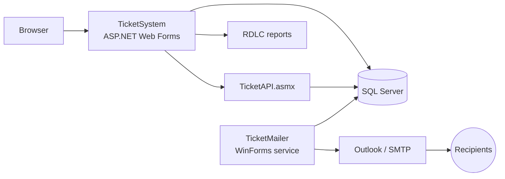

<div align="center">

# 🎫 Ticket System

**Web-based helpdesk for raising, routing and reporting support tickets, with an automated Outlook mailer.**

[](https://github.com/mr-aybee/ticket-system/actions/workflows/ci.yml)


[](LICENSE)

</div>

---

## Overview

Ticket System is an ASP.NET Web Forms helpdesk application. Users sign up, raise tickets with attachments and CC recipients, and track them through their lifecycle; operators triage unassigned tickets and act on them. RDLC reports summarise tickets and users, an ASMX API exposes ticket operations to other systems, and the companion **TicketMailer** desktop service sends ticket notifications through Outlook.

## Features

- 👤 **Accounts** — sign-up, login and session-based access
- 📝 **Ticket creation** with subject, CC, domain, supervisor and attachments
- 📥 **My Tickets** and **Unassigned Tickets** queues
- ⚙️ **Operations** view for acting on tickets
- 📊 **RDLC reports** for tickets and users
- 🔌 **ASMX web API** (`TicketAPI.asmx`) for integrations
- ✉️ **TicketMailer** — scheduled e-mail notifications via Outlook, HTML templates

## Architecture



## Tech stack

| Component | Technology |
| --- | --- |
| Web app | C# · ASP.NET Web Forms · .NET Framework 4.5 |
| API | ASMX web service |
| Reporting | Microsoft RDLC (ReportViewer) |
| Data | SQL Server (`TicketSystem_Killhouse_Schema.sql`) |
| Mailer | WinForms + Outlook Interop |

## Getting started

### Prerequisites

- Windows with Visual Studio 2019+ (ASP.NET and web development workload)
- SQL Server (Express or LocalDB is fine for development)
- Microsoft Outlook (only for TicketMailer)

### Setup

```shell
git clone https://github.com/mr-aybee/ticket-system.git
cd ticket-system
nuget restore TicketSystem.sln
```

1. Create a database and run `TicketSystem_Killhouse_Schema.sql`.
2. Update the connection string in `TicketSystem/Web.config` (replace `CHANGE_ME` placeholders — never commit real credentials).
3. Open `TicketSystem.sln`, set **TicketSystem** as the startup project and run with IIS Express.

## Usage

1. Register on **Sign Up**, then log in.
2. Raise a ticket on **Create Ticket**; track it under **My Tickets**.
3. Operators work **Unassigned Tickets** and update status in **Operations**.
4. Open **Reports** for ticket and user summaries.
5. Run **TicketMailer** on a machine with Outlook to send notifications on a schedule.

## Project structure

```text
ticket-system/
├── TicketSystem/            # Web Forms app: pages, Ticket.Master, API/, RDLC_Reports/, EmailTemplates/
├── TicketMailer/            # Outlook notification service (WinForms)
└── TicketSystem_Killhouse_Schema.sql
```

## Development

- Build the web project with `msbuild TicketSystem/TicketSystem.csproj`.
- CI builds the web application on Windows for every push and pull request. TicketMailer needs Outlook Interop, so it is built locally only.
- Use disposable databases and mailboxes while developing.

## Contributing

Contributions are welcome. Read [CONTRIBUTING.md](CONTRIBUTING.md) for the branch, build and pull-request workflow. Please report security issues privately through [GitHub security advisories](https://github.com/mr-aybee/ticket-system/security/advisories/new), not public issues.

## Code of Conduct

This project follows the [Contributor Covenant](CODE_OF_CONDUCT.md). By participating you agree to uphold it.

## License

Released under the [MIT License](LICENSE). © 2026 Abdullah Shahid.
